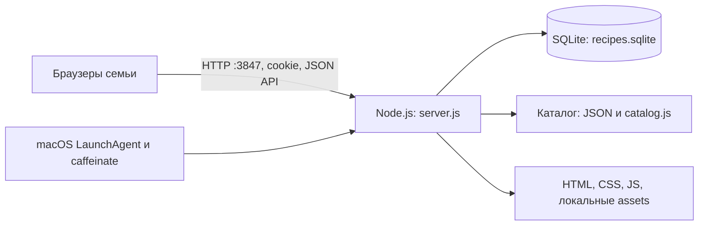

# «Крошка»: фактическая архитектура

Обследовано 22 октября 2026 года, commit [`68c554a`](https://github.com/nikitadudka/recepts/commit/68c554a4c19d80cf17a6cb8be8b3363cdb534c3d), версия `package.json` — `2.0.0`. Документ описывает код в репозитории; состояние установленного семейного Mac не обследовалось.

Продуктовое направление обновлено после PR №1: персональные аккаунты, облачное размещение и целевая БД PostgreSQL утверждены владельцем, но ещё не реализованы. React, TypeScript, Next.js, Tailwind CSS, shadcn/ui и современная архитектура backend подлежат техническому аудиту и сравнению вариантов; стек не выбран. План безопасной миграции — в [ROADMAP](ROADMAP.md), решения D008–D014 — в [DECISIONS](DECISIONS.md). До отдельного одобрения реализации фактическая архитектура ниже сохраняется.

## Схема работы

Исходная база A04 — `main` `b135dfb` с объединёнными PR №11 (A10.1/CI) и №12 (A22); после PR №14 ветка обновлена до `main` `547d6b5` с исправлением перезапусков тестового сервера и CI-регрессией. По поручению владельца от 22.10.2026 реализованы клиентское отложенное обновление карточек и статус просмотра из [технической спецификации Этапа 1](stage-1/TECHNICAL_SPEC.md); [QA и границы A04](stage-1/A04_QA.md), [история A22](stage-1/A22_QA.md). API списка каталога A07 не реализован. Схема и список API сохраняются.



Один процесс Node обслуживает клиент и API с одного origin. Прокси, TLS-сервер, облачное размещение и масштабирование в репозитории не настроены. По умолчанию сервер доступен всем сетевым интерфейсам на `0.0.0.0:3847`, а допустимый пользовательский сценарий — доверенная домашняя сеть.

## Технологии и зависимости

- Клиент: обычные HTML, CSS, JavaScript, DOM, `fetch`, `<dialog>`, Canvas для уменьшения фотографий, SVG для иллюстраций и анимации. React, Vue, TypeScript, bundler и отдельная сборка не используются.
- Сервер: Node.js >=22.13, ES modules (`type: module`); встроенные `node:http`, `node:sqlite` (`DatabaseSync`), crypto, fs, path, os и url. Express и ORM отсутствуют.
- Производственных и разработческих npm-зависимостей в `package.json` нет; lockfile отсутствует. Для обычного запуска `npm install` не требуется.
- Проверки: встроенный Node test runner; Python 3 `unittest`, Pillow, Python Playwright и Chromium. Версии и hashes Python wheels закреплены в `tests/requirements.txt` (A10.1).
- Установка: shell-скрипты macOS, `launchctl`, `caffeinate`, `plutil`, `sips`, `iconutil`, системные `curl`/`open` и установленный отдельно Node.js.
- Ресурсы: локальные шрифты Golos Text, Manrope и Lora с OFL-лицензиями; изображения поставляются в репозитории. Приложение не обращается к AI API.

## Карта репозитория

| Путь | Назначение |
| --- | --- |
| `index.html`, `style.css` | Разметка, формы, диалоги, адаптивное оформление |
| `app.js` | Состояние книги, API, поиск, редактор, импорт/экспорт, каталог, конфликты, синхронизация, старые браузерные данные |
| `theme.js`, `halloween.css`, `catalog.css` | Сезонная тема, её переключатель и оформление каталога |
| `server.js` | HTTP, авторизация, SQLite, миграции, валидация, API и список разрешённой статики |
| `catalog.js` | Загрузка и нормализация встроенного каталога, поиск и случайная выборка |
| `recipes.seed.json` | 8 примеров для первоначального заполнения семейной базы |
| `catalog/recipes.json`, `cocktails.json` | 1 527 блюд и 40 коктейлей; отдельные неизменяемые справочные данные |
| `catalog/image-index.json` | 1 567 соответствий ID рецепта → WebP-лист и координаты |
| `catalog/image-prompts.json`, `image-generation.json` | 98 заданий и записей происхождения/упаковки иллюстраций; не runtime AI-функция |
| `catalog/SOURCES.md`, `SOURCE-README.md` | Источники и преобразования каталога, копия README исходной подборки |
| `assets/` | 98 WebP-листов, кошка, начальные иллюстрации, иконки, шрифты и лицензии |
| `manifest.webmanifest`, `sw.js`, `offline.html` | Основа установки в браузере и экран отсутствия связи |
| `scripts/build-catalog.py`, `build-cocktails.py` | Подготовка JSON-каталога; первый требует отдельного исходного корпуса |
| `scripts/register-image-sheet.py`, `sheet_geometry.py` | Регистрация листов, перекодирование в WebP и определение прямоугольников; используется Pillow, в регистрации — `fcntl` |
| `Установить Крошку.command`, `mac/` | Установщик, запускатель `.app`, генератор LaunchAgent plist |
| `tests/` | Установщик, геометрия изображений, API и браузерные сценарии |
| `.env.example`, `.gitignore`, `package.json` | Настройки-пример, исключения данных/секретов и команды |
| `README.md`, `Начать здесь.txt` | Пользовательские инструкции |
| `AGENTS.md`, `docs/` | Общие правила агентов, продуктовая/архитектурная документация и порядок передачи работ в AGENT_WORKFLOW |

В обследованном исходном дереве нет GitHub Actions, Docker-конфигурации, отдельного мобильного проекта, формального API/schema-файла или общего файла лицензии проекта. Это не утверждение об отсутствии настроек вне репозитория. Упомянутого в README автономного Halloween-превью в Git нет.

## Сервер, API и согласованность

| Метод и путь | Поведение |
| --- | --- |
| `GET /healthz` | Открытая проверка процесса: `{app: 'kroshka', version: 2}`; не полная проверка сохранности/восстановления |
| `GET /api/session` | Состояние входа и возможность первоначальной настройки |
| `POST /api/setup`, `/api/login` | Первый пароль только с loopback и локальным Host; вход по семейному паролю |
| `POST /api/logout` | Удаление текущей сессии |
| `GET /api/library?revision=...` | Вся книга с revision либо `unchanged` |
| `PUT /api/library` | Валидация и замена состава всей книги при совпадении revision; конфликт — HTTP 409 |
| `GET /api/catalog`, `/api/catalog/art` | Размер/разделы каталога и индекс иллюстраций |
| `GET /api/catalog/random` | Поиск/случайная запись; параметры `q`, `kind`, `exclude` |
| `POST /api/catalog/:id/save` | Идемпотентное сохранение в `main`/`trial`; перенос существующей пробы в книгу |
| `POST /api/trials/:id/promote`, `DELETE /api/trials/:id` | Перенос/удаление пробы; защита от удаления уже перенесённого блюда |
| `GET /api/connection` | Домашние IPv4 и необязательный `.local`-адрес для телефона |

После setup/login все перечисленные семейные/каталожные методы требуют сессию. HTML и разрешённые ресурсы, включая WebP-листы, доступны без входа; семейные данные и сам JSON-каталог через статический сервер не выдаются.

`app.js` последовательно выполняет записи через `writeQueue`. Видимая авторизованная страница опрашивает книгу раз в 5 секунд, используя общую revision. Это polling, не WebSocket и не синхронизация автономных копий. В A04 принятый снимок помечает отложенную перерисовку: карточки обновляются после `close` последнего диалога, в том числе после Escape/backdrop/программного закрытия. Ответ `unchanged` не сбрасывает эту отметку. Поиск, фильтры, сортировка и grid/list сохраняются; фокус заново находится по ID/действию, при исчезновении записи — на заголовке выдачи. Переход просмотр → редактор не перерисовывает книгу между диалогами.

Открытый просмотр сохраняет читаемый снимок. При изменении/удалении записи `role=status` сообщает об этом; «Обновить просмотр» применяет уже принятые данные с сохранением доступной позиции чтения. Удалённая запись имеет только безопасный возврат; её действия отключены. У перенесённой пробы отключаются устаревшие delete/promote. Редактор и фото при polling не заменяются. При 409 клиент перечитывает книгу; прежний `editingSnapshot` позволяет обнаружить изменение и сохранить форму копией. Сервер, API, схема и очередь записи A04 не меняются; [QA и ограничения](stage-1/A04_QA.md).

Основная запись — полный снимок `{revision, recipes}` до 10 000 рецептов. В транзакции `BEGIN IMMEDIATE` сервер удаляет отсутствующие ID, записывает новые/изменённые и повышает revision. Каталог и действия над пробами имеют отдельные транзакционные операции. При развитии API нужно сохранить эти гарантии и учесть стоимость передачи всей книги с фото.

### Обработка JSON (A22)

Все семь изменяющих route/method-пар выше требуют UTF-8 JSON object до чтения полей и изменения данных. `null`, массивы, скаляры, повреждённые JSON/UTF-8, пустое тело и одни пробелы — 400. Исключение совместимости: `POST /api/logout` принимает нулевое тело либо object; проверка непустого тела происходит до отзыва сессии. Неизвестные ключи допустимы, прежняя валидация полей рецептов не меняется. Корректная пустая книга `{revision, recipes: []}` остаётся явной допустимой операцией клиента; ошибки никогда не преобразуются в неё автоматически.

Media type без учёта регистра должен быть ровно `application/json`; параметры допускаются, явно заданный charset — только `utf-8` (включая кавычки). Отсутствующий/чужой тип, `application/jsonx`/`application/jsonp` и чужой charset — 415. Лимиты реально прочитанных байтов включительны: library 67 108 864, остальные шесть маршрутов 4096; превышение — читаемый JSON 413 с отбрасыванием остатка потока без накопления. При оборванном соединении данные не меняются; доставку ответа отключившемуся клиенту гарантировать нельзя.

Порядок: Origin → media type → setup/login/auth guards → существование catalog ID → размер/JSON/container → поля/прежние проверки 404/409 → транзакция. Счётчик login по прежнему увеличивается до parsing. Все ошибки сохраняют `{error: string}`, JSON Content-Type и `Cache-Control: no-store`. Реальные ошибки SQLite/IO остаются 5xx, повреждённые сохранённые данные не заменяются пустыми. Семантика `revision`, транзакции и клиентская очередь записи сохраняются.

## SQLite и модель рецепта

База — `DATA_DIR/recipes.sqlite`, WAL, `busy_timeout=5000`. SQL выполняется синхронно в процессе сервера; ORM и отдельного сервера БД нет.

| Таблица | Поля и назначение |
| --- | --- |
| `settings` | `key TEXT PRIMARY KEY`, `value TEXT NOT NULL`: revision, scrypt-хеш пароля, маркеры миграций `catalogArtVersion`, `cookingActionsVersion` |
| `sessions` | `token TEXT PRIMARY KEY`, `expires INTEGER NOT NULL`: SHA-256 токена и срок в миллисекундах |
| `recipes` | `id TEXT PRIMARY KEY`, `content TEXT NOT NULL`: сериализованный JSON рецепта |

Рецепт содержит `id`, `title`, `time`, `servings`, `meal`, `size`, `macro`, `meat`, `favorite`, `createdAt`, `ingredients[{name,amount,unit}]`, `instructions`, `image`, `calories`, `protein`, `fat`, `carbs`. Неизвестные БЖУ хранятся как `null`. Дополнительные поля: `steps` (при наличии соединение через `\n` должно совпадать с `instructions`), `cookingMethods`, `equipment`, `isPreparation`, `shelf`, `catalogId`, `recipeKind`, `sourceTitle`, `sourceUrl`. Отсутствующий `shelf` трактуется клиентом как основная книга; новый список проб — `trial`.

Изображения не хранятся отдельными пользовательскими файлами: `image` — пустая строка, `sample:<name>`, `art:<catalogId>` или data URL JPEG/PNG/WebP. Фото уменьшается в браузере до максимальной стороны 1000 px и конвертируется в JPEG quality 0.8. Клиент принимает исходный файл до 15 МБ, сервер ограничивает строку изображения 3 МиБ; общий JSON-запрос по умолчанию до 64 МиБ, setup/login и малые операции — 4096 байт.

При запуске сервер создаёт схему, заполняет примеры при отсутствии revision, при необходимости задаёт пароль из окружения и выполняет транзакционные миграции. Добавление иллюстраций старым копиям каталога сохраняет пользовательские фото; нормализация прежних способов готовки сохраняет остальные поля. Отдельного механизма версионированных SQL-миграций пока нет.

## Конфигурация, запуск и установка

```sh
npm start
```

Команда использует `node --env-file-if-exists=.env server.js`. Прямой `node server.js` сам `.env` не читает; установщик macOS задаёт переменные через LaunchAgent.

| Переменная | По умолчанию / смысл |
| --- | --- |
| `PORT` | `3847` |
| `HOST` | `0.0.0.0` |
| `DATA_DIR` | `data/` рядом с `server.js`; для тестов всегда отдельный временный каталог |
| `KROSHKA_HOSTNAME` | Необязательное имя `Family-Mac.local` для окна подключения |
| `FAMILY_PASSWORD` | Необязательное первоначальное задание пароля, если его ещё нет в базе; секрет, не для Git. UI требует 8–128 символов; env-путь проверяет минимум 8 |
| `PUBLIC_URL` | Учитывается в проверке Origin и добавляет `Secure` cookie при `https:`; TLS, прокси и публикацию не настраивает |

Mac-установщик копирует приложение в `~/Library/Application Support/Kroshka/app`, данные отделены в `~/Library/Application Support/Kroshka/data`, логи — в соседнем `logs`. Создаёт `~/Applications/Крошка.app` и `~/Library/LaunchAgents/dev.kroshka.recipes.plist`. LaunchAgent запускает `caffeinate -s` и Node при входе пользователя, сохраняет процесс запущенным. Обновление копирует файлы приложения и не заменяет базу. `.app` открывает localhost в браузере и при необходимости запускает агент; это не нативный клиент рецептов.

## Безопасность и резервирование

Пароль: соль и scrypt; сессия: случайный 32-байтовый токен, в базе его SHA-256, срок до 30 дней. Cookie: `HttpOnly`, `SameSite=Strict`, `Secure` только по `PUBLIC_URL`. Вход ограничен 20 попытками за 15 минут по адресу сокета; состояние лимита живёт в памяти процесса. Есть проверка Origin для изменяющих запросов, JSON Content-Type, валидация рецептов, параметризованный SQL, список разрешённой статики, `nosniff`, `X-Frame-Options: DENY` и Referrer-Policy.

Эти меры не превращают локальную версию в готовый публичный сервис: нет TLS, пользователей/семей и восстановления пароля, распределённого ограничения входа или настроенной модели доверия прокси. Origin при отсутствии заголовка не отклоняется; за прокси лимит по адресу сокета может объединить пользователей. Интернет-развёртывание требует отдельной проверки.

JSON-экспорт формируется в браузере как `{version: 1, exportedAt, recipes}` и включает рецепты с фото/ссылками на локальные иллюстрации, но не пароль и сессии. Импорт добавляет данные, а изменённые совпадающие ID превращает в копии. Для резервирования всей базы используйте согласованный SQLite-consistent backup или остановленный сервер с корректной обработкой WAL; копирование одного живого `.sqlite` ненадёжно. Автоматического резервирования в коде нет. Рабочие данные и `.env` исключены из Git.

## PWA, проверки и границы подтверждения

Manifest содержит иконки и `display: standalone`. Регистрация service worker выполняется только в secure context; он кэширует только `offline.html`, делает network-first навигацию и не хранит рецепты, пароли или ответы API. Обычный HTTP на LAN-адресе не равнозначен HTTPS/localhost. Автономного редактирования и фоновой синхронизации нет.

```sh
npm run check
npm test
```

Для отдельного тестового Python-окружения, если зависимости отсутствуют:

```sh
python3 -m venv /tmp/kroshka-qa-venv
. /tmp/kroshka-qa-venv/bin/activate
python -m pip install --require-hashes --only-binary=:all: -r tests/requirements.txt
python -m playwright install --with-deps chromium
```

При нехватке системных библиотек Chromium подготовьте окружение средствами своей платформы. Эти команды не нужны пользователю установленного приложения. В Linux минимальных образах могут требоваться дополнительные пакеты ОС. `tests/smoke.py` использует `CHROMIUM_EXECUTABLE`, системный `chromium`/`google-chrome` или браузер Playwright.

`check` проверяет синтаксис пяти JS-файлов, не является линтером и не покрывает `sw.js`. `npm test`: 2 проверки установщика/генератора plist, 1 проверка геометрии листов, 8 API-групп A22 (`tests/json_api_test.py`, без браузера) и 52 API/браузерных сценария: прежние 45 плюс 7 регрессий A04. Всего 63 теста; матрицы используют subtests. A04 проверяет две сессии, фактический GET новой revision, последний снимок/unchanged, закрытие/переходы/несколько диалогов, фокус/прокрутку/фильтры, явное обновление просмотра, удаление/перенос и сохранение формы с фото. Настоящие службы macOS и реальные Safari/iOS/Android ими не проверяются. CI добавлен в A10.1; конфигурация и границы — ниже.

При обследовании 22 октября 2026 года в Linux на Node.js 24.19.0 выполнены `npm run check` и `npm test`: синтаксис и все 46 проверок прошли. Для тестов потребовалось разрешить дочерние процессы и локальные сокеты за пределами ограниченной песочницы; код и тесты ради окружения не менялись.

Новые архитектурные предложения заносятся в [DECISIONS](DECISIONS.md), порядок работ — в [ROADMAP](ROADMAP.md).

На базе `main` `6aa62ee` после PR №1 и №2 подготовлены [TECH_AUDIT](audits/TECH_AUDIT.md) со сравнением стеков и предварительным runbook PostgreSQL и [QA_AUDIT](audits/QA_AUDIT.md) с новым прогоном 46 проверок и двумя дополнительными воспроизводимыми дефектами. Архитектура приложения не изменялась; миграция и восстановление рабочей базы не выполнялись. Предложения ожидают review владельца.


## Воспроизводимый baseline A10.1

Одобрение — [D017](DECISIONS.md#d017-частично-одобренная-реализация-stage1-v1), база `main` `631c3b1`. Runtime и визуальный интерфейс не меняются. `.github/workflows/tests.yml` запускает `npm run check` и прежний полный `npm test` на PR в `main` и push в `main`. Две matrix job выполняются на отдельных чистых `ubuntu-24.04` x86_64 runner без cache и retry: Node 24.19.0, Python 3.12.14, отдельный venv. Actions закреплены SHA опубликованных checkout v4.2.2, setup-node v4.4.0, setup-python v5.6.0; checkout не сохраняет credentials. Только `contents: read`, без секретов, deployment и auto-merge. Branch protection не изменяется.

`tests/requirements.txt` фиксирует прямые и транзитивные инструменты с SHA-256 **Linux x86_64 / CPython 3.12 wheels**: Playwright 1.62.0, Pillow 12.3.0, greenlet 3.5.6, pyee 13.0.1, typing_extensions 4.16.0. Это test-зависимости; production/npm dependencies не добавлены. Для macOS/другой архитектуры этот manifest намеренно не обещает совместимость: нужны проверенные wheels/хеши отдельным изменением, не отключение hash-check.

На Linux с указанными Node/Python из корня checkout:

```sh
python3 -m venv /tmp/kroshka-qa-venv
. /tmp/kroshka-qa-venv/bin/activate
python -m pip install --require-hashes --only-binary=:all: -r tests/requirements.txt
export PLAYWRIGHT_BROWSERS_PATH=/tmp/kroshka-qa-browsers
python -m playwright install --with-deps chromium
export CHROMIUM_EXECUTABLE="$(python - <<'PY'
from playwright.sync_api import sync_playwright
with sync_playwright() as p:
    print(p.chromium.executable_path)
PY
)"
python tests/browser_environment.py
npm run check
npm test
python tests/ci_failure_checks.py
```

Установка системных библиотек Chromium может требовать административных прав; GitHub runner поддерживает её. Playwright закрепляет Chromium **151.0.7922.34, revision 1234**. CI явно передаёт bundled executable: fallback на случайный системный браузер исключён. `browser_environment.py` проверяет наличие/запуск и пишет фактическую версию. Отсутствие инструмента/браузера — ошибка job. До установки и в логах доступны image version/ОС, Node/Python/pip и все Python-пакеты. GitHub OS image и apt-пакеты меняются; побайтовая идентичность ОС не заявляется. В log сохраняются версии, artifacts с БД/cookie/exports не выгружаются.

Smoke запускает `node server.js` без чтения `.env`, на loopback с новым временным `DATA_DIR`; игнорирует унаследованные FAMILY_PASSWORD/PUBLIC_URL. Очистка класса зарегистрирована сразу после создания каждого ресурса и срабатывает даже при ошибке setup/запуска Chromium; закрываются browser/Playwright/актуальный процесс после restart и временная БД. Каждый browser context очищается и при провале setUp/tearDown. `ci_failure_checks.py` в отдельной временной копии проверяет ненулевой exit `npm test` при отсутствующем Chromium и намеренно падающем Node-тесте, а также отсутствие оставшихся процессов/БД. Исходный checkout не ломается; ожидаемые отрицательные опыты не заменяют обязательный полный зелёный прогон.

Перезапуски smoke используют тот же ограниченный TERM → ожидание 10 s → KILL → wait, что и cleanup: открытое браузерное соединение может удерживать graceful `server.close()` после закрытия listener. Перед отрицательными опытами `ci_failure_checks.py` запускает `tests/server_lifecycle_test.py`: исходный браузерный сценарий перезапуска при удерживаемом неполном HTTP-запросе, проверка сохранности рецепта/сессии и очистки. Workflow и полный `npm test` не меняются. Диагностика сбоя main после PR №12 и ограничения доказательств — [CI_RESTART_QA](stage-1/CI_RESTART_QA.md).

Обновление: отдельным PR проверить upstream release/action SHA, скачать wheels с PyPI в чистую среду, сверить и записать хеши всех зависимостей, обновить версии и browser build, повторить оба чистых baseline и негативные проверки. Не ослаблять проверки и не обновлять runtime автоматически. Регрессии A22/A04 приходят с их отдельными исправлениями. Результаты и ограничения конкретного прогона — [A10.1 QA](stage-1/A10_1_QA.md); Linux не подтверждает macOS и реальные iOS/Android.
