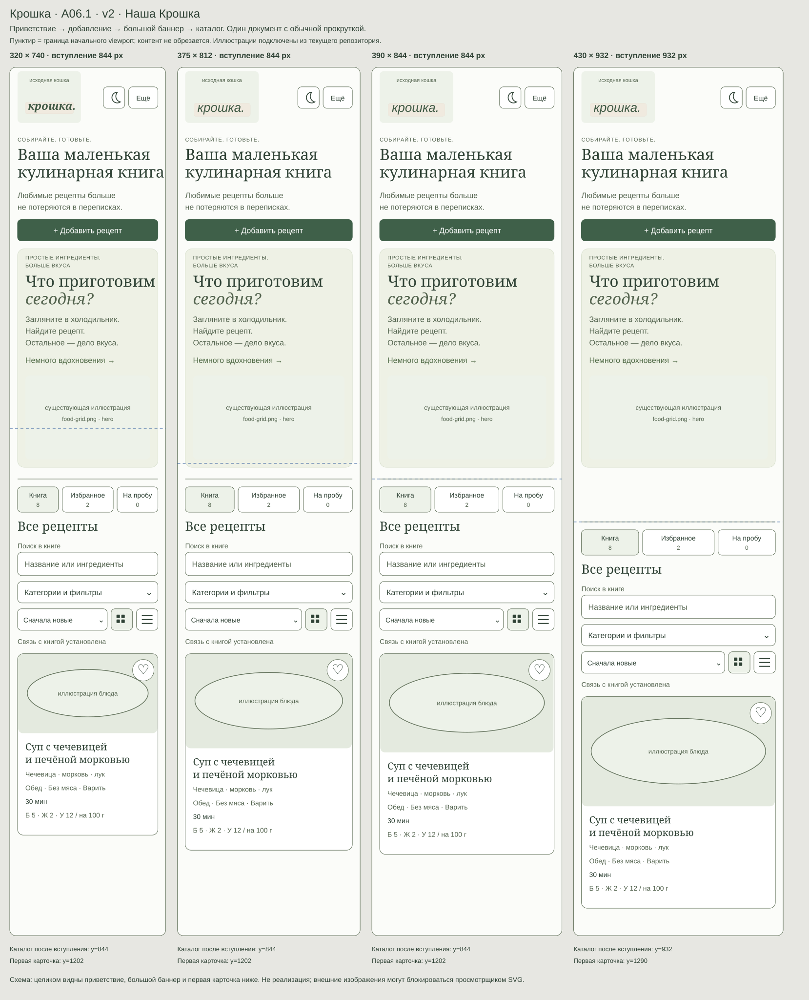
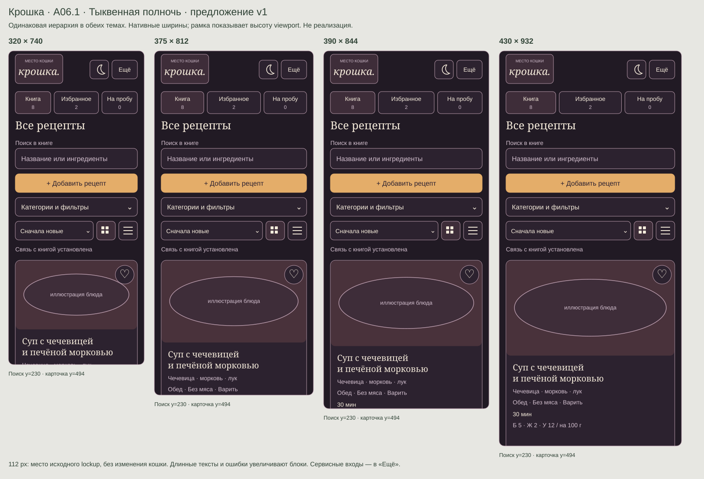
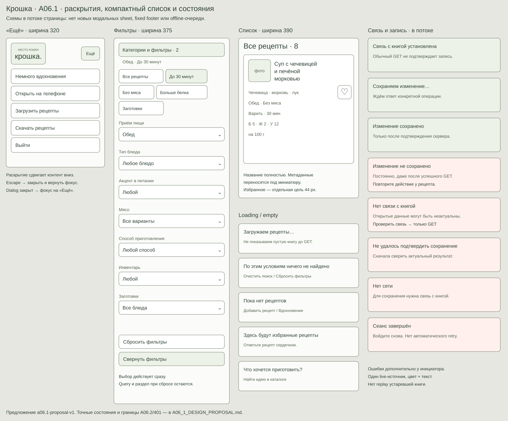
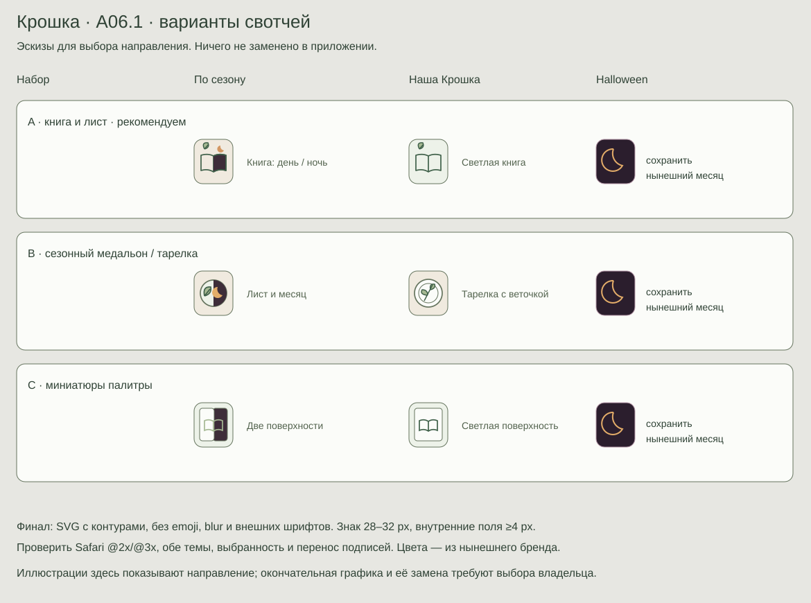

# A06.1 — мобильная главная, навигация и состояния

**Версия: a06.1-proposal-v1 · 23 октября 2026 · статус: предложение для согласования.**

Задача — [Issue №8, A06](https://github.com/nikitadudka/recepts/issues/8). База: актуальный `main` [`7a080a615afed90820d0122e38ee52626143f4f6`](https://github.com/nikitadudka/recepts/commit/7a080a615afed90820d0122e38ee52626143f4f6), проверенный через GitHub; PR №16 объединён. Ветка: `docs/a06-1-design-proposal`. Ведущая роль — UX/UI Designer & Researcher; Product, техническую оценку и проверку документа совмещает один агент. Это самопроверка, независимый QA не проводился.

Прямое поручение владельца от 23 октября разрешает исследование, этот документ, схемы и документационный PR. **Рабочий интерфейс, изображения тем и кошка не изменяются.** После согласования владелец подготовит отдельное задание на реализацию. Согласование документа или его merge само по себе такого задания не заменяет.

## 1. Основания и границы доказательств

Прочитаны [AGENTS](../../AGENTS.md), [PRODUCT](../PRODUCT.md), [ARCHITECTURE](../ARCHITECTURE.md), [ROADMAP](../ROADMAP.md), [DECISIONS](../DECISIONS.md), [AGENT_WORKFLOW](../AGENT_WORKFLOW.md), README, [PLAN](PLAN.md), [BACKLOG](BACKLOG.md), [MOBILE_UX_SPEC](MOBILE_UX_SPEC.md), [QA_PLAN](QA_PLAN.md) и [исследование конкурентов](../audits/COMPETITOR_RESEARCH.md). Более узких AGENTS в полном дереве базы нет.

Факты ниже установлены чтением **текущих** `index.html`, `app.js`, `style.css`, `halloween.css`, `catalog.css`, `theme.js`, включая поздние переопределения CSS. Старые скриншоты и координаты из аудита не считаются новым замером.

На этапе подготовки облачная среда оставалась `pending/offline`; исходники прочитаны через GitHub connector по указанному SHA. Сервер, Chromium, macOS Safari и iPhone не запускались; вычисленные размеры, реальные переносы и координаты не измерены. Схемы — новые векторные макеты для review, не снимки приложения и не подтверждение работы Safari. Реальные данные пользователей не использовались. Локальные `git status` / `git diff --check` и просмотр макетов в браузере требуют доступного executor; результат проверки указан в передаче в конце.

Это уточнение **только A06.1** относительно MOBILE_UX_SPEC v1. Оно не меняет контракты A04/A05, не запускает A06.2/A07. Историческое «A06 не запускается» в старых решениях относится к реализации; новое поручение разрешает эту документационную фазу.

### Как использовано прежнее исследование

[COMPETITOR_RESEARCH](../audits/COMPETITOR_RESEARCH.md) от 22.10.2026 содержит источники и ограничения: Paprika Android guide описывает категории отдельно на телефоне и рядом со списком на планшете; гостевой Cookpad US отделяет свою коллекцию от общего поиска. Здесь используем только принципы «категории рядом с поиском» и «книга отдельно от вдохновения». Новый доступ к аккаунтам конкурентов, замеры их UX и интервью не проводились. Удобство предложенного решения пока гипотеза для проверки, функциональность конкурентов не переносится.

## 2. Текущее состояние и конкретные проблемы

Источники: [index.html](../../index.html), [style.css](../../style.css), [halloween.css](../../halloween.css), [catalog.css](../../catalog.css), [app.js](../../app.js), [theme.js](../../theme.js) на базовом commit.

| Область | Факт по текущему коду | Проблема / следствие для A06.1 |
| --- | --- | --- |
| Шапка | При ≤680 px высота `.topbar` 124 px; lockup кошка/логотип 151 px по ширине, при ≤360 — 130 px. Тема, «Открыть на телефоне», «Выйти» остаются рядом | Сервисные действия занимают место повседневного поиска; на 320 px подписи уменьшаются до 7–8 px |
| Навигация | «Все рецепты», «Избранное», «Блюда на пробу» есть на телефоне. Навигация абсолютно расположена на `top:135px`; ниже 399 px иконки скрыты. Категории `.meal-nav` скрыты, но доступны через `filter-meal` | Связь расположения с фиксированной высотой шапки хрупка при увеличении текста; категории трудно обнаружить |
| Порядок главной | Шапка → коллекции → приветствие/добавление → hero → заголовок коллекции → поиск/фильтры → быстрые условия → сортировка/вид → карточки | Основное повторное действие «найти своё блюдо» стоит после декора |
| Hero | Classic min-height 235 px, Halloween 420 px (410 px на ≤360); у последнего есть большой фон и сезонный текст | Темы создают разный путь к книге. Это CSS-минимумы, не замер фактической высоты |
| Поиск и фильтры | Позднее правило уже даёт поиску 16 px и min-height 44 px; фильтр имеет текст и min-height 44 px. Семь select: две колонки, при ≤360 одна. Быстрые условия прокручиваются горизонтально без видимого scrollbar | Нельзя повторять старый вывод о 10 px в поле поиска как текущий факт. Однако поиск делит строку с кнопкой фильтров, а часть быстрых условий не видна сразу |
| Карточки | Две колонки от правила ≤960 сохраняются на телефоне. На 390 px по CSS получается около 169,5 px на карточку (350 px контейнер, gap 11). Поздние размеры: название 19 px с clamp 2 строки, ингредиенты 11 px, время 12 px, БЖУ 10 px | Длинное название визуально обрезается, строки тесны. На 320 px карточка примерно 134,5 px; точная геометрия требует браузера |
| Касания и вид | Избранное уже 38×38, переключатели grid/list ≥44×44, quick chip min-height 42. Grid/list и пять сортировок работают | Довести оставшиеся основные цели до 44 px; не выдавать уже существующий grid/list за новую функцию |
| Сохранение | `persist()` ведёт `writeQueue`, пишет статус перед PUT и после ответа. Ошибка формы остаётся в `#form-error`, toast исчезает через 4 с. На телефоне `.home-status{display:none}` | Вне редактора ошибка после toast не видна постоянно; статус записи нельзя прочитать на телефоне |
| Синхронизация | `refreshLibrary()` после GET пишет «всё сохранено», polling раз в 5 с ждёт очередь. Online вызывает GET. Сохранение каталога/проб использует очередь, но не все операции выставляют тот же status | GET может скрыть предыдущую ошибку записи; состояние связи не доказывает успешное сохранение. Это вывод из handlers, новый сетевой опыт не проводился |
| A04/A05 | Есть отложенный render, уведомление об удалённом изменении, dirty protection, семантика pressed, status/live regions и контрастные токены | Эти исправления нужно сохранить. Старые открытые замечания аудита к ним нельзя считать текущими без перепроверки |
| Safe area / клавиатура | Используются dvh и нижний inset в footer редактора/каталога. Главная не имеет общего учёта inset; viewport без `viewport-fit=cover` | Полной поддержки вырезов, landscape и клавиатуры код не доказывает. Нужна проверка реальных устройств |
| Темы | Auto/classic свотчи — символы `✦`/`✳` на CSS-фоне, мобильный свотч 46×58. Тема локальная, auto 20–31 октября по устройству | Системный шрифт/emoji не обеспечивает фирменный и одинаковый вид на Retina |

Известные белые вертикальные полосы возле кошки в macOS/iPhone Safari **остаются открытыми после PR №16**: [CAT-SAFARI-STRIPES в BACKLOG](BACKLOG.md#cat-safari-stripes--белые-полосы-возле-кошки). Основание — сообщение владельца и отказ Safari-приёмки в материалах PR №16. В этой фазе нет повторного анализа PNG/SVG/анимации, исправления, clipping или новой версии кошки.

## 3. Рекомендуемая компоновка

Рекомендуем **одну колонку карточек на телефоне**, существующие разделы над поиском, фильтры в раскрываемой панели внутри страницы и обычную прокрутку. Не вводим нижнюю навигационную панель: три существующих раздела помещаются сверху, фиксированная нижняя панель добавила бы риск перекрытия клавиатурой и конфликт с текущими modal footer.

### Главная при ≤680 px

1. **Шапка min-height 88 px + top safe area.** Исходная цельная кошка с логотипом: ширина lockup 112 px, пропорции сохраняются (около 69 px высоты), без изменения изображения/анимации. Справа тема 44×44 и «Ещё» ≥60×44, gap ≥8. На 320 px это помещается в 288 px контента; лишнее место не расходуется на мелкие сервисные подписи. При увеличении текста шапка растёт и переносит действия.
2. **Группа разделов** «Книга», «Избранное», «На пробу»: min-height 52 px, названия 14 px, счётчик второй строкой, при переполнении блок растёт. «Книга» — короткая мобильная подпись существующих «Все рецепты», «На пробу» — существующих «Блюда на пробу», не новые сущности. Ширины в отношении 1:1,25:1, gap 8; без горизонтального скрытия пунктов. Выбранное обозначено контуром/подложкой и `aria-pressed`.
3. **Заголовок текущей выдачи**: «Все рецепты», «Избранное», «Блюда на пробу» или текущая категория; 26/34 px, без большого приветственного блока. Число результатов подписано отдельно от общих счётчиков разделов.
4. **Видимая подпись «Поиск в книге»** (в пробах «Поиск в блюдах на пробу»), поле 48 px на всю ширину, ввод 16 px, placeholder «Название или ингредиенты». Очистка — область ≥44×44. Поиск расположен до добавления и декора.
5. **«Добавить рецепт»**, 44 px на всю ширину. Открывает существующий редактор и сохраняет его текущую логику, в том числе при входе из проб; не обещает нового назначения shelf. Существующий путь «Найти идею в каталоге» в пустых пробах сохраняется.
6. **«Категории и фильтры»**, 44 px на всю ширину; справа число активных условий, не только select. Ниже при необходимости видны текущие условия.
7. **Сортировка и grid/list**: min-height 44 px; отдельная строка на всех четырёх ширинах. При 200% текста сортировка и вид расходятся по строкам.
8. **Компактная строка состояния** в потоке min-height 28 px. В спокойном состоянии «Связь с книгой установлена»; saving/error/offline раскрывают столько строк, сколько нужно. Содержимое всегда доступно скроллом, не накладывается поверх карточек.
9. **Выдача**: одна карточка на строку. Полноширинный hero переносится в компактный вход **после первой карточки**: 44 px, «Немного вдохновения» / существующая сезонная подпись, перенос текста разрешён. Дополнительный вход во вдохновение — в «Ещё». Каталог остаётся сегодняшним random-диалогом; списка результатов A07 здесь нет. При пустой выдаче вход в каталог находится после блока объяснения.

Строка статуса и инструменты не sticky; шапка также в потоке. Так сохраняется высота короткого viewport и исключается наложение новых панелей на клавиатуру. Ошибка не исчезает по таймеру; после действия у карточки сообщение дополнительно находится рядом с этой карточкой, чтобы пользователь не искал его вверху длинного списка.

### Геометрия для согласования

Все размеры — CSS px, portrait, обычный текст, safe area = 0, раздел с данными, панель фильтров закрыта, нет активных условий/ошибки. Отступы 16 px по краям, вертикальные промежутки 8/12 px. Координаты ниже — **цели макета**, не результат работы сайта.

| Параметр | 320×740 | 375×812 | 390×844 | 430×932 |
| --- | --- | --- | --- | --- |
| Полезная ширина | 288 | 343 | 358 | 398 |
| Шапка | y=0…88 | y=0…88 | y=0…88 | y=0…88 |
| Разделы | y=96…148 | y=96…148 | y=96…148 | y=96…148 |
| Заголовок / подпись поиска | y=160…194 / 206…226 | то же | то же | то же |
| Поле поиска | y=230…278 | то же | то же | то же |
| Добавление / фильтры | y=290…334 / 346…390 | то же | то же | то же |
| Сортировка / статус | y=402…446 / 454…482 | то же | то же | то же |
| Начало первой карточки | y=494 | y=494 | y=494 | y=494 |
| Фото 16:9 | 288×162 | 343×193 | 358×201 | 398×224 |
| Начало названия первой карточки, примерно | y=672 | y=703 | y=711 | y=734 |

На 320 px одно длинное название карточки увеличивает её высоту; это допустимо. На 430 px фото остаётся внутри первого экрана, но не растягивается в отдельный hero. На всех ширинах полное название доступно без открытия. Пороги приёмки: верх поля поиска ≤240 px, первая карточка ≤520 px, начало её названия ≤760 px для обычного короткого названия. При safe area координаты считаются от начала содержимого после верхнего inset. Для крупного текста, ошибок, раскрытых условий, длинного заголовка раздела и короткого landscape пороги координат не применяются: доступность содержимого важнее фиксированной высоты.

Это **осознанное уточнение** прежней цели MOBILE_UX_SPEC «поиск ≤180 px / название ≤620 px»: предлагаем сохранить целую узнаваемую кошку и явные три раздела, поэтому поиск на схеме y=230. Альтернатива для владельца — поставить поиск сразу под шапкой, а разделы и заголовок ниже; поиск будет раньше примерно на 100 px, но изменится порядок навигации. Рекомендуем текущий вариант с навигацией над поиском; выбор фиксируется до реализации.

### Визуальные схемы

[Classic: 320 / 375 / 390 / 430](a06-1/home-classic.svg) · [Halloween: те же ширины](a06-1/home-halloween.svg) · [Меню, фильтры и состояния](a06-1/behaviors.svg) · [Варианты иконок](a06-1/theme-options.svg).

Схемы показывают CSS-ширины в масштабе 1:1; изображения блюда обозначены условно. Место кошки — подписанная рамка с логотипом, чтобы не создавать новую графику маскота. Они не заменяют согласование финального вида на текущих локальных шрифтах и реальном устройстве.

## 4. Поведение навигации, меню, поиска и фильтров

### Разделы и возврат

Переходы сохраняют текущую логику: выбор коллекции сбрасывает только meal; запрос, остальные select, quick, сортировка и вид остаются. Пробы отделены от main/favorites, общие счётчики не равны числу найденного с условиями. Категории — текущий фильтр по приёму пищи, а не новый тип коллекций. На телефоне они открываются через «Категории и фильтры»; на планшете/desktop боковые входы остаются.

После просмотра закрытие возвращает к той же карточке и позиции по A04; если запись исчезла — фокус на заголовок выдачи. Не вводим URL-роутинг, новую историю browser Back и запоминание раздела после reload. При сохранении рецепта сохраняется текущий переход/сброс query, filters и сортировки из submit-handler; улучшение этого поведения — отдельное продуктовое решение, не скрытая часть перестановки блоков.

### «Ещё»

Обычный disclosure с подписанными кнопками, без `role=menu`. Раскрывается в потоке сразу после шапки, растёт под текст и доступен прокруткой. Содержимое: существующее вдохновение, «Открыть на телефоне», «Загрузить рецепты», «Скачать рецепты», «Выйти». Выход визуально отделён, импорт сохраняет прежнее подтверждение. На телефоне убрать дубли этих сервисных кнопок из шапки/нижнего footer; desktop остаётся как есть.

Enter/Space открывает; фокус остаётся на «Ещё», затем обычный Tab. Escape закрывает и возвращает фокус; клик снаружи закрывает без прокрутки страницы к началу. Открытие существующего dialog закрывает disclosure; закрытие dialog возвращает фокус на «Ещё», если его внутренняя кнопка теперь скрыта. Панель не модальная, фон не inert. Смена темы не сбрасывает query/filters/scroll. Сервисные действия не добавляются поверх открытого редактора; его защита dirty и modal-поведение не обходятся.

### Поиск

Только текущий поиск по названию/ингредиентам, все значимые слова, ё/е и простые окончания. Нет AI, опечаток, поиска по шагам или нового server API. Поле не заменяется DOM-узлом при render, клавиатура/каретка сохраняются. Очистка снимает только query, оставляя остальные условия. Счётчик объявляется через уже существующую polite-область с задержкой, без озвучивания сетки на каждый символ. Нативное поведение search/cancel проверяется на iPhone; не должно быть двух одинаковых очисток в Tab-порядке.

### Панель фильтров

Одна панель внутри страницы, `aria-expanded/controls`, **без вложенного sheet/modal и без кнопки «Применить»**: выбор, как сейчас, действует сразу. Сверху быстрые условия («Все рецепты», «До 30 минут», «Без мяса», «Больше белка», «Заготовки») с прежней взаимоисключающей quick-логикой; они переносятся строками и имеют высоту ≥44 px. Далее семь существующих select, включая «Приём пищи». Все 320–430 px — одна колонка; на планшете остаётся существующая сетка. Названия и значения не переопределяем.

Фокус при раскрытии остаётся на кнопке; Tab идёт в quick, затем select и «Сбросить фильтры». Явная кнопка «Свернуть фильтры» в конце позволяет закрыть длинную панель и вернуть фокус на её вход; Escape из панели сворачивает её, когда не открыт системный select. Смена значения не сворачивает панель и не прокручивает к выдаче автоматически. Результат и число обновляются сразу.

Под кнопкой виден переносимый текстовый итог: «Обед · До 30 минут · Без мяса», если условия есть; query читается в самом поле. Это сводка текущего состояния, не новые removable chips. Число на входе равно числу непустых select + одному quick, если quick ≠ all. Запрос и выбранный раздел в число фильтров не входят. Не добавляем удаление каждого условия (раннее предложение затрагивало A07); отдельное условие меняется в своём select.

«Сбросить фильтры» сохраняет query и раздел, сбрасывает семь select и quick, как нынешний `resetFilters()`. В пустом результате при наличии условий доступны отдельные «Очистить поиск» и «Сбросить фильтры»; не называем очистку всей книги «Сбросить». При двух противоречащих условиях не меняем правила молча: показываем честный нулевой результат.

### Сортировка и grid/list

Пять нынешних значений: новые, быстрые, больше белка / жиров / углеводов на 100 г. Не добавляем алфавит, рейтинг или иной tie-breaker. Текущий вариант виден; длинное значение доступно нативному select, подпись и доступное имя сохраняются. Select занимает остаток строки, две кнопки вида — по 44 px с gap 8; при нехватке ширины перенос, а не уменьшение текста.

«Плитка» на телефоне становится одной большой карточкой на строку; «Список» — компактной горизонтальной карточкой с фото 72×72 и полным названием, текстовая часть `min-width:0`, избранное отдельной соседней целью 44 px. На 320 px метаданные уходят под название. В обоих видах остаются нынешние ингредиенты, категории/способ, время и БЖУ; их не скрывают ради компактности. В пробах под карточкой остаются «В книгу рецептов» и удаление ≥44 px; подтверждение удаления прежнее.

Название карточки 20/26 px, без line-clamp; ингредиенты и метаданные 14/20 px, неизвестное БЖУ — «—», подпись «на 100 г» сохранена. Порции в карточку не добавляем: сейчас это данные подробностей, макет их не переносит. Фото 16:9 в плитке, не меняет исходные данные/кадрирование в редакторе; без фото — нынешняя заглушка. Состояние избранного меняется после подтверждения сервера, не по таймеру. Все интерактивные действия соседние, без вложенных кнопок.

Вид и сортировка сохраняются в памяти текущей страницы при поиске/filter/render/sync; сохранение после reload не добавляется.

## 5. Loading, empty, error, offline и запись

Показываем **два независимых факта**: связь с сервером и результат конкретной записи. GET, online event или смена темы не подтверждают PUT/POST/DELETE. Приоритет глобального сообщения: ошибка записи → запись выполняется → ошибка связи → подтверждённая операция → спокойная связь. Более поздний успех иной операции не стирает неразрешённую ошибку.

| Состояние / источник | Видимый текст и действие | Данные, фокус, доступность |
| --- | --- | --- |
| Первое открытие, session/library ещё ожидается | «Открываем книгу…» на текущем экране входа; после auth «Загружаем рецепты…» в области выдачи | Не показывать «0»/seed как загруженную книгу до GET; `aria-busy`, без фокуса на skeleton |
| Книга загружена | «Связь с книгой установлена» | Не утверждает сохранение dirty editor; не озвучивать каждый polling |
| Запись началась, ответ задержан | «Сохраняем изменение…» + локальное имя действия | Нынешняя очередь без перестройки; повтор того же действия недоступен на время запроса; смена коллекции не отменяет операцию |
| Запись подтверждена сервером | «Изменение сохранено» | Только ответ соответствующей мутации. Polite-сообщение один раз; затем спокойный текст допустим, ошибка другой операции остаётся |
| Ошибка записи вне формы / 5xx | «Изменение не сохранено» + конкретная причина и имя действия | Постоянная полоса и сообщение у инициатора. Toast — дополнение. Не менять сердечко/удалять пробу как при успехе |
| Повтор после ошибки | «Повторите действие у рецепта»; после восстановления связи нужная кнопка снова доступна | Не добавлять универсальную кнопку replay всей книги. Повтор — существующее действие с актуальными данными/revision; удаление повторно требует прежнее подтверждение |
| Сетевой ответ потерян после возможного commit | «Не удалось подтвердить сохранение. Проверяем связь…» | GET сверяет актуальное состояние; не выдумывать rollback. Если нужный результат виден в свежем снимке, можно явно подтвердить его; иначе ошибка остаётся. Слепой повтор toggle/delete недопустим |
| Фоновый GET не прошёл | «Нет связи с книгой. Уже открытые данные могут быть неактуальны» + «Проверить связь» | Снимок остаётся видим, не подменяется пустой книгой. Повтор выполняет только GET; не очищает ошибку записи |
| Offline / navigator.onLine=false | «Нет сети. Для сохранения нужна связь с книгой» | Navigator — сигнал, а успешный API — доказательство связи. Нет persisted drafts, offline queue и обещания автономной книги |
| Первое открытие без сервера | «Не удалось загрузить книгу» + «Повторить подключение» | Использовать текущий retry; не принимать недоступность сервера за неверный пароль или пустую выдачу. Offline fallback service worker остаётся нынешним, без нового кэша рецептов |
| Пустая основная книга | «Пока нет рецептов» + существующие «Добавить рецепт» / вход во вдохновение | Отличается от loading/error; основной вход добавления остаётся сверху |
| Пустое избранное | «Здесь будут избранные рецепты» + объяснение сердечка | Не добавлять чужие/каталожные записи; можно перейти существующей кнопкой «Книга» |
| Пустые пробы | «Что хочется приготовить?» + прежний «Найти идею в каталоге» | Объяснить отдельность проб и перенос; не смешивать main/trial |
| Нет совпадений при условиях | «По этим условиям ничего не найдено», query/итог фильтров видны | Раздельные очистка query и сброс фильтров, раздел остаётся; это presentation существующих операций |
| 401 | «Сеанс завершён. Войдите снова» | Не повторять запись автоматически. Оставить нынешний вход; не обещать восстановление формы после reload. Поведение открытого редактора после reauth относится к отдельной технической оценке A06.2 |
| 409 / remote change | Понятная причина конфликта; в редакторе прежняя «Сохранить копию» | Нынешние A04/409/dirty protection сохраняются, никакого принудительного overwrite |
| Ошибка формы / 413 / неверное фото | Нынешняя inline-ошибка и связанное поле | A06.1 не перестраивает редактор. Сохранить ввод/фото и уже существующие объявления/фокус; исправление формы — A06.2 |

Глобальное сообщение — в потоке после инструментов, `role=status` для обычного изменения, alert только для новой ошибки пользовательской записи. Ошибка у карточки не создаёт второе одинаковое live-объявление. Текст переносится полностью, рядом текстовый признак/значок: цвет не единственный носитель состояния. Внутри modal используются его существующие области сообщений; фоновые объявления не конкурируют с dialog. Ошибка формы не переносится в далёкую главную.

Для нескольких действий не вводим журнал или новую очередь: используем идентичность текущей операции, держим неразрешённую ошибку видимой и не скрываем её чужим успехом. Если безопасная сверка неоднозначного результата потребует новых контрактов/модели pending-операций, реализация этой части останавливается с техническим handoff; в минимальном A06.1 оставляем честное «Не удалось подтвердить» и повтор через просмотр актуального рецепта. Автоматический retry и новый офлайн-механизм не разрешены.

## 6. Safe area, клавиатура, планшет и компьютер

- Мобильный контейнер: padding слева/справа `max(16px, env(safe-area-inset-left/right))`, сверху inset, снизу `max(16px, env(safe-area-inset-bottom))`. Добавление `viewport-fit=cover` допустимо только в будущем согласованном UI PR с регрессией всех нынешних полноэкранных dialog. В этой фазе meta не меняется.
- Высота главной — по содержимому; не привязывать её к 100vh. Нет новых фиксированных нижних/верхних панелей. Доступны ручная прокрутка и системный zoom; не применять `user-scalable=no` или блокировку жестов.
- Поиск 16 px; фокус не ставится автоматически при открытии главной/меню/фильтров. При экранной клавиатуре поле и системная кнопка «Найти» доступны; ввод не теряется при изменении visual viewport. Не вызывать scrollIntoView при каждом input/render.
- Landscape 844×390 и standalone с вырезом: горизонтальные inset соблюдены, длинная панель прокручивается всей страницей. У текущих editor/catalog footer проверить отсутствие регрессии от общих CSS и meta; изменение их компоновки, ингредиентов, чтения и нижних действий — A06.2.
- Breakpoint **680 px сохраняется**. 681–767: нынешняя промежуточная композиция с sidebar, отдельная регрессия 680/681. Не распространять новый телефонный layout на планшет молча.
- 768×1024, 1024×768, 1440×1000: существующие sidebar, hero, число колонок, desktop-сервисные входы и типографика сохраняются. Новое честное поведение статуса применимо к desktop в нынешнем месте, без редизайна. Общие селекторы обязательно ограничить, чтобы телефонный размер карточки не затронул desktop.
- При text zoom 200% / reflow 320 CSS px все контролы переносятся и растут. Ни один пункт навигации или сообщение не скрывается. Клавиатурный порядок соответствует визуальному; положительные tabindex/ручной Tab-loop не вводятся.
- Контраст A05: обычный текст ≥4,5:1, крупный/значимые границы и focus по применимым условиям ≥3:1; фокус 2 px / offset 2 px. Нынешние токены и reduced motion сохранены; новая графика проверяется в обеих темах.

## 7. Иконки переключателя тем — варианты до замены

Зарегистрированы [A06.1-THEME-AUTO и A06.1-THEME-CLASSIC](BACKLOG.md). Замечания владельца подтверждены как сообщения о iPhone Safari; модель/версии не указаны, повторной проверки здесь нет.

| Набор | «По сезону» | «Наша Крошка» | Оценка |
| --- | --- | --- | --- |
| **A — рекомендуемый** | Открытая книга: светлая и тёмная страницы, небольшой месяц над правой, лист над левой; единый чёткий контур без сложного градиента | Та же открытая книга с маленьким листом на кремовом фоне, шалфейный контур | Связывает выбор с кулинарной книгой, легко сделать чётким на малом размере, не использует новый образ кошки |
| B — более декоративный | Круглый медальон «лист / месяц» с двумя спокойными половинами | Кремовая тарелка с веточкой шалфея | Теплее и предметнее, но тарелка слабее связывает набор с логотипом |
| C — буквальная миниатюра тем | Два маленьких прямоугольника цвета поверхностей и единый знак книги | Светлая мини-карточка книги, рядом существующий знак логотипа без кошки | Яснее показывает палитру, но похож на настройку интерфейса и менее выразителен |

В рисунке A/B — векторные эскизы, C — схема палитр. **Ни один не является утверждённым финальным asset.** Существующий Halloween-месяц и подписи сохраняются; для новых auto/classic задать сопоставимые размер, силуэт и вес. Если владелец захочет рисованный маскот/новый Halloween-знак, нужен отдельный согласованный графический объём.

Требования к будущему финальному файлу: локальный SVG без внешних шрифтов/emoji, явный viewBox, отступ рисунка ≥4 CSS px от края свотча, штрих примерно 1,5–2 CSS px на конечном размере. Свотч минимум 48×56, внутри знак около 28–32 px; при 320 px подписи занимают остаток и переносятся, вся option — цель ≥44 px. Не использовать blur, сложные маски или растровое увеличение маленькой картинки. Предпочтителен SVG; если будет выбран растр — подготовить @2x/@3x из качественного оригинала.

Проверить @1x/@2x/@3x, iPhone Safari, обе темы и увеличенный текст: контуры/внутренние края чёткие, ничего не обрезано, выбранность видна галочкой/контуром и `aria-pressed`. `auto/classic/halloween`, даты 20–31 октября, localStorage и sync выбора между вкладками не меняются. Декоративная иконка `aria-hidden`, имя режима берётся из текста. До выбора владельцем изображения не заменять.

## 8. Что останется без изменений

- HTML/CSS/JS, Node.js и SQLite, структура runtime, API/модель/формат рецептов; никаких зависимостей и миграций.
- Нынешние правила query, select/quick, сортировки, main/trial/favorites, редактора, удаления/подтверждения, каталога/random, импорта/экспорта и совместимости старых JSON.
- Revision, транзакции, writeQueue, защита от дублей и stale trial delete, фото и источники, A04 и доступность A05.
- Desktop-дизайн, текущие локальные шрифты, фирменная палитра, исходная кошка и её анимация, сезонная логика. Исправление Safari-полос вынесено за пределы A06.1.
- Ни A06.2, ни A07, cooking mode, Wake Lock, undo, autosave, persisted drafts, новые категории/аккаунты, offline-кэш или облако не начинаются.

## 9. Критерии приёмки будущей реализации

Все пункты пока **не выполнены: реализации нет**. После утверждения конкретной версии — отдельный PR и протокол с результатами «прошёл / не прошёл / не проверен». Применяется [QA_PLAN](QA_PLAN.md), только A06.1; сценарии узких ингредиентов/нового чтения остаются A06.2.

| ID | Проверка / ожидаемый результат |
| --- | --- |
| AC01 | Обе темы, 320×740, 375×812, 390×844, 430×932: соответствие порядку и геометрическим порогам §3 при базовых условиях; screenshot и bounding boxes. Нет горизонтального overflow документа |
| AC02 | На каждой ширине все три раздела и счётчики доступны без горизонтального скролла; поиск/добавление до выдачи, вдохновение после первой карточки и в «Ещё», категории через подписанный вход |
| AC03 | Quick/семь select/сводка/сброс имеют описанную область действия. Query, сортировка, вид и выбранная коллекция не теряются от раскрытия панели, темы или GET |
| AC04 | Плитка и список различимы, полные длинные названия до 100 символов переносятся, данные карточки не исчезают; favorite/promote/delete ≥44×44 и не перекрывают открытие. Все пять сортировок прежние |
| AC05 | Slow PUT/POST/DELETE, failure/5xx, неоднозначный сетевой исход, последующий успешный GET и другая успешная операция: нет ложного «всё сохранено», ошибка остаётся после 4 с и polling. Повтор идёт через актуальное действие, не stale snapshot |
| AC06 | Initial loading, пустая книга, избранное, пробы, ноль по условиям, ошибка первой загрузки и offline различаются. Загруженный снимок не очищается при failed GET; нет обещаний offline save |
| AC07 | 401/409, два контекста, изменение/удаление/перенос: A04 snapshot/render/focus и dirty form сохраняются; новые уведомления не перехватывают фокус и не обходят существующую защиту |
| AC08 | Keyboard-only меню → тема → фильтры → карточка → возврат; Escape, Tab/Shift+Tab, labels/pressed/expanded, результаты и ошибки без двойных live-объявлений. Проверка screen reader с названием/версией, отсутствие устройства — «не проверено» |
| AC09 | 200% текст/zoom, reflow до 320, reduced motion: все действия достижимы; обе темы проходят контраст/focus на фактических фонах, включая новые сообщения |
| AC10 | Реальные iPhone Safari и Android Chrome, portrait/landscape/standalone: search keyboard, clear, safe area, browser bars, rotation, фон→возврат, нативные select. Записать модель/OS/браузер; Linux UA-тест не считается Safari |
| AC11 | 680/681, 768/1024, 1024/768, 1440/1000: desktop/tablet композиция не меняется; поиск/filter/grid/list/modal и нынешние footer не регрессируют. Сравнительные снимки до/после |
| AC12 | Если отдельно одобрены иконки — приёмка THEME-AUTO/CLASSIC на iPhone @2x/@3x; выбор/сезон/keyboard не меняются. Без выбора графики этот пункт остаётся отложенным и картинки сохраняются |
| AC13 | Синтетические наборы 8, 100, 1000 рецептов, длинные тексты/отсутствующее фото/БЖУ, пробы и две сессии; нет потери фокуса при render/polling, состав данных/revision/фото/источников соответствует операциям |
| AC14 | После одобренных UI-изменений выполнены `npm run check`, профильные регрессии и `npm test` по AGENTS; только временный DATA_DIR и loopback. Реальные устройства отдельно, без заявления о полной WCAG-сертификации |

Белые полосы кошки не являются критерием исправления A06.1 и не должны исчезать из backlog по результатам этого PR. Если обнаружится новое перекрытие логотипа изменённой шапкой, это регрессия компоновки, которую отличают от прежнего дефекта.

## 10. Риски и варианты снижения

| Риск | Как ограничить / проверить |
| --- | --- |
| Уменьшенная кошка хуже узнаётся; поиск ниже старой цели 180 px | Показать владельцу lockup 112 px и альтернативный порядок; одобрить до кода, проверить на реальном экране |
| Одна колонка увеличивает длину страницы | Grid/list оставлены; список имеет миниатюру и все данные. Не вводить виртуализацию/пагинацию как скрытое архитектурное изменение |
| Quick спрятаны в панели и требуют лишнего нажатия | Подписанный вход и видимый итог условий; на review сравнить с альтернативой «quick всегда снаружи», которая добавит 2–3 строки до карточек |
| Меню скрывает редкие действия | Полная подпись «Ещё», прежние названия кнопок, доступность импорта/экспорта/подключения с клавиатуры |
| Смена DOM нарушит A04/A05, Tab или фокус возврата | Не дублировать обработчики/ID, устойчивые узлы инструментов, возврат на «Ещё» для скрытого инициатора; повторить текущие регрессии |
| Тема переписывает `.page-heading`/hero через `theme.js` | При реализации согласовать владельцев DOM: сезонный текст не должен затирать заголовок коллекции или добавлять убранный hero. Логика режима/дат неизменна |
| Глобальный CSS/viewport-fit затронет dialog и tablet | Mobile-scoped правила, 680/681 и все dialog/footer в обеих темах; отдельная проверка keyboard/inset |
| Несколько записей и GET скрывают error, потерян ответ commit | Статус связан с операцией; GET не очищает ошибку. Не строить новый retry engine; неоднозначность явно видна, безопасная сверка прежде повторного действия |
| Документ обещает больше, чем есть 401/offline | Границы §5, нет persisted draft/кэша; контракт редактора A06.2 отдельно |
| SVG-эскиз выглядит хорошо, но asset мылится на iPhone | Эскиз не финальный asset; нативные файлы/встроенные контуры, реальная @2x/@3x приёмка до замены |
| Полосы кошки ошибочно объявят исправленными | Отдельная открытая запись CAT-SAFARI-STRIPES, не анализировать/не менять изображение в A06.1 |

Технически компоновка реализуема локальными изменениями нынешнего клиента без новых API/БД. Оценка объёма — M из существующего backlog, не обещание срока. Альтернатива минимального вмешательства: оставить две колонки и hero, только перенести поиск выше; она сохраняет тесные карточки и различие тем, поэтому не рекомендуется.

После отдельного задания реализацию разделить по reviewable шагам внутри A06.1: мобильная компоновка/навигация; представление статусов поверх текущих операций; выбранные иконки только при отдельном подтверждении. При необходимости это несколько PR, без смешивания с A06.2/A07. Откат будущего UI — revert соответствующего изменения кода, без отката SQLite, импорта старой книги или удаления новых записей. В этой документационной фазе откат данных не нужен.

## 11. Решения владельца и handoff

| Вопрос | Рекомендация |
| --- | --- |
| R1. Порядок и геометрия | Одобрить §3: lockup 112 px / шапка 88 px, разделы над поиском, поиск y≈230. Либо выбрать поиск сразу под шапкой вместо прежнего порога 180 |
| R2. Карточки и фильтры | Одна колонка плитки + компактный список; quick внутри раскрываемых категорий/фильтров, сводка снаружи, без нового bottom nav |
| R3. Сервисные входы и вдохновение | «Ещё» с подключением/импортом/экспортом/выходом; компактное вдохновение после первой карточки и в меню |
| R4. Статусы | Постоянное представление ошибок, связь отдельно от записи, без автоматического replay/offline-очереди; неоднозначный исход не выдаётся за успех |
| R5. Графика тем | Выбрать набор A/B/C или оставить текущие изображения до отдельного графического задания; рекомендуем A |
| R6. Реальные устройства | Определить проверяющего iPhone Safari / Android Chrome, записать модели/версии; отдельная задача на полосы кошки остаётся открытой |

Для фиксации решения: «Согласована a06.1-proposal-v1 из commit …, R1=…, R2=…, R3=…, R4=…, R5=…; следующий шаг — отдельное задание на реализацию A06.1». Не трактовать молчание как согласие. Непринятые варианты явно остаются предложениями.

**Передача:** UX/UI + Product → владелец. Канонический результат — этот документ и четыре SVG рядом. Следующий ответственный — владелец для выбора компоновки и графики, затем отдельное задание Developer / Architect и QA. Issue №8 не закрывать автоматически: A06.2 не начат. Merge, auto-merge и деплой не выполняются.

Проверки этой фазы: факты сверены с текущими handlers и полным каскадом CSS; программная самопроверка относительных файловых ссылок, парности SVG-тегов, отсутствия скриптов/внешних ресурсов в SVG, trailing whitespace и завершающего перевода строки прошла для всех 12 изменяемых файлов. Это ограниченная текстовая проверка, не XML-валидатор и не визуальный просмотр. Локальные `git status` / `git diff --check`, запуск сервера и браузерный просмотр не выполнены: executor оставался pending/offline. Изменения публикуются через GitHub Git Data API поверх проверенного main в отдельной ветке; перед передачей проверяется состав удалённого diff. Макеты не подтверждают текущую геометрию сайта. Новые тесты приложения не добавлялись; `npm test` не запускался для документации.
