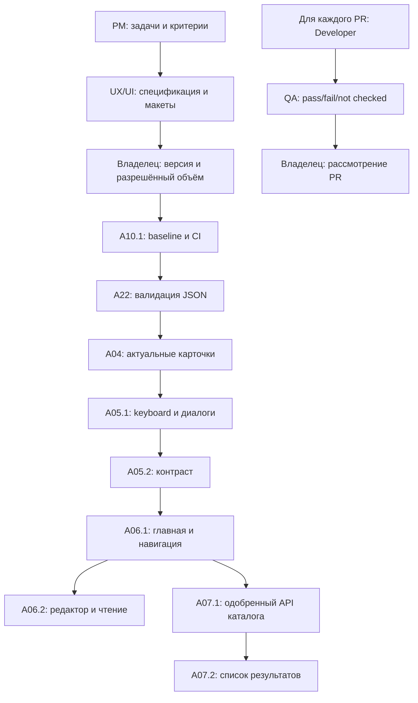

# Этап 1 разработки: стабилизация и мобильный веб

Актуализация A05.1 от 22.10.2026: владелец прямым поручением разрешил только клавиатуру, семантику, диалоги, регрессии и документацию Issue №7. База — `main` `45909b5`, PR №13/№14 объединены; ветка `fix/a05-1-accessibility`, [PR №15](https://github.com/nikitadudka/recepts/pull/15). [Самопроверка и передача](A05_1_QA.md). Это дополнение к прежнему частичному одобрению ниже; A05.2/A06/A07, цвета, компоновка, merge и деплой не разрешены.

Актуализация A04 от 22.10.2026: PR №12 объединён; прямым поручением владельца начата реализация Issue №6 на `main` `b135dfb` в `fix/a04-sync-cards`. [QA и передача](A04_QA.md); следующий ответственный — владелец для review, merge/деплой запрещены. Ниже сохранена история исходного пакета; прежнее ожидание A22 для A04 снято этим поручением.

## Актуальное решение владельца

22.10.2026 владелец явно разрешил **stage1-v1** из [PR №10](https://github.com/nikitadudka/recepts/pull/10), commit `dddcc2fae078ca054feedf222af77c9638a011c1`, только в объёме **A10.1 → A22 → A04**, QA и технических улучшений этих задач. A10.1 включает установку закреплённых существующих test-инструментов и CI. Каждая задача — отдельная ветка/PR, Developer → QA → одобрение владельца **до начала следующей**. Новые UX/UI-макеты, визуальный стиль, цвета и компоновка, смена стека, миграция БД, деплой и merge/auto-merge не разрешены. Тесты только на синтетических данных и временных `DATA_DIR`. A05/A06/A07 не запускаются. Источник — прямое поручение владельца в рабочем чате; [фиксация PM в PR №10](https://github.com/nikitadudka/recepts/pull/10#issuecomment-6342478089), [Issue №4](https://github.com/nikitadudka/recepts/issues/4), [№5](https://github.com/nikitadudka/recepts/issues/5), [№6](https://github.com/nikitadudka/recepts/issues/6).

База текущего A10.1 — `main` `631c3b1`; ветка `ci/a10-1-reproducible-checks`. Ниже сохранён исходный пакет предложения; прежние формулировки «ожидает одобрения» заменены решением выше только для указанного объёма. Результат A10.1 и статус приёмки — в [отчёте QA](A10_1_QA.md).

Версия предложения: **stage1-v1**, 22 октября 2026 года. Ведущая роль — Product Manager. **Статус: Review владельца; реализация не разрешена.** Версия для одобрения определяется этой меткой вместе с commit документационного PR: последующие изменения объёма требуют нового подтверждения.

## Что подготовлено

Это первый этап **разработки** после аудита PR №3: A04, A05, A06, A07, A10 и A22. В прежнем [ROADMAP](../ROADMAP.md) «Этап 1» назывался аудитом; его история сохраняется. Здесь не начинается повторный аудит и не меняется нумерация старых этапов: данный пакет конкретизирует согласование и качество веба из прежних этапов 2–3.

Канонические материалы пакета:

- [Задачи, приоритеты и границы PR](BACKLOG.md) — проблема, ценность, решение, компоненты, риски, приёмка и QA для каждого ID.
- [Мобильная UX/UI-спецификация](MOBILE_UX_SPEC.md) — сравнение текущих экранов с предложением, макеты и состояния.
- [Технические контракты](TECHNICAL_SPEC.md) — минимальные исправления, варианты, тестовое окружение и API каталога.
- [План QA](QA_PLAN.md) — воспроизводимые проверки и условия передачи владельцу.
- [GitHub Issues](ISSUES.md) — ссылки, статусы, следующий ответственный.
- [Проверка этого пакета](REVIEW.md) — выполненные проверки документов и ограничения.

## Исходные факты и границы доказательств

База — `main` **33347143b1028808ff1ce3ad2b9ebe5822b8e72f**, проверенная через GitHub 22.10.2026. PR [№1](https://github.com/nikitadudka/recepts/pull/1), [№2](https://github.com/nikitadudka/recepts/pull/2) и [№3](https://github.com/nikitadudka/recepts/pull/3) объединены. Перед публикацией пакета база проверяется повторно.

Исходный `/workspace/recepts` был чистым, ветка `work`, commit `68c554a`. `git fetch origin main` не прошёл: локальный proxy недоступен. Поэтому актуальные AGENTS и все текстовые документы `docs/` получены через GitHub connector по точному SHA, снимки — из того же commit. Все **147 файлов вне AGENTS/docs** сверены `git hash-object` с деревом GitHub: совпадают. Работа идёт в отдельных локальных worktree; локальный snapshot-commit не выдаётся за remote main. Документационный commit GitHub строится поверх указанного remote main и меняет только документы/спецификации.

Прочитаны [AGENTS](../../AGENTS.md), [PRODUCT](../PRODUCT.md), [ARCHITECTURE](../ARCHITECTURE.md), [ROADMAP](../ROADMAP.md), [DECISIONS](../DECISIONS.md), [AGENT_WORKFLOW](../AGENT_WORKFLOW.md), README, относящиеся исходники и все шесть отчётов:

| Источник | Что используем |
| --- | --- |
| [PRODUCT_AUDIT](../audits/PRODUCT_AUDIT.md) | Основные пути «сохранить → найти → открыть», разделение книги и каталога |
| [UX_UI_AUDIT](../audits/UX_UI_AUDIT.md) и его скриншоты | UX-01–07, 10–12, 14; фактические размеры и дефекты доступности |
| [COMPETITOR_RESEARCH](../audits/COMPETITOR_RESEARCH.md) | Разделение библиотеки и каталога; адаптивные приёмы, без копирования всего объёма конкурентов |
| [TECH_AUDIT](../audits/TECH_AUDIT.md) | Сохранение текущего стека, revision, транзакций и совместимости |
| [QA_AUDIT](../audits/QA_AUDIT.md) | Воспроизведённые QA-01/02 и пробелы проверок |
| [IMPROVEMENT_PLAN](../audits/IMPROVEMENT_PLAN.md) | Исходные ID A04–A07/A10/A22; уточнённая очередь этого пакета |

46 прошедших тестов — **исторический результат PR №3**, не новый прогон этого пакета. Новые макеты — предложения, не снимки изменённого сайта. Реальные пользователи, телефоны и рабочая база сейчас не исследовались. Для A04 подтверждено рассогласование DOM, для A22 — ложный 500; доказанной потери серверных данных в этих опытах нет.

## Приоритеты и порядок

Приоритеты ниже относятся к этому этапу, а не переписывают историческую оценку серьёзности аудита. A22 поднимается из P2 общего backlog в первую очередь разработки: контролируемая валидация должна предшествовать расширению UI/API. P0-инцидент потери данных не объявляется.

| Очередь | Пакет / размер PR | Польза и условие начала |
| --- | --- | --- |
| 0 | Этот документационный PR | PM → UX/UI → review технических рисков и QA → владелец. Изменений приложения нет |
| 1 | **A10.1**, S/M: воспроизводимый baseline и CI | После отдельного одобрения конфигурации окружения. Закрепить существующие инструменты, запускать штатные проверки на PR, без деплоя |
| 2 | **A22**, S/M: JSON и регрессии | После одобрения контракта ошибок. Один PR с серверным исправлением и проверками; не ждать UX-редизайна |
| 3 | **A04**, S/M: синхронизация и регрессии | После одобрения поведения открытого просмотра/формы. Один PR, без редизайна главной |
| 4 | **A05.1**, S: клавиатура/семантика/диалоги; **A05.2**, S/M: контраст | Два PR после одобрения соответствующей UX-спецификации; keyboard-сценарий не зависит от цветов |
| 5 | **A06.1**, M: главная/навигация/статус; **A06.2**, M: редактор/чтение | Отдельные PR по одобренным макетам; A04 и A05 проверены. Сохранение формы и доступность остаются обязательными |
| 6 | **A07.1**, S/M: контракт и выдача read-only API; **A07.2**, M: поиск/каталог UI | Два PR; API только после явного одобрения нового endpoint. UI после API, A05 и мобильного каркаса A06.1 |

Это порядок review/интеграции, не обещание календарных сроков. Внутри A10 новые регрессии добавляются **в PR соответствующего исправления**, а не заранее как падающие проверки. A10 завершается после подключения регрессий всех одобренных задач; A10.1 при этом уже может быть принят. Отсюда нет цикла «A10 ждёт все исправления, исправления ждут A10».

Если подготовка CI блокируется окружением, PM фиксирует блокер и возвращает владельцу вариант: разрешить A22/A04 с воспроизводимым локальным прогоном штатного набора и профильных проверок либо ждать A10.1. Это не разрешение обходить проверки или автоматически менять зависимости. Код A22 и A04 логически независим; технически их можно готовить отдельно после одобрения, интеграцию сейчас планируем последовательно.

Стрелки верхней части задают рекомендуемую очередь. Обязательные технические зависимости перечислены отдельно у каждой задачи в BACKLOG. Окончательный переход к следующей задаче — по её разрешённому объёму; рассмотрение PR владельцем не означает автоматического слияния агентом.

## Работа четырёх ролей

В этом пакете Product Manager — координатор; UX/UI, Developer / Architect и QA — отдельные агенты с непересекающимися файлами в отдельных worktree одного локального репозитория. Architect сейчас выполняет анализ, QA — проверку требований и документов. Это не QA ещё несуществующей реализации и не внешнее тестирование пользователями.

| Передача | Что требуется для следующего шага |
| --- | --- |
| PM → UX/UI | База, подтверждённые проблемы, сценарии, ограничения, ID задач и приёмка |
| UX/UI → владелец через PM | Сравнения экранов, состояния, варианты и рекомендация; Architect и QA проверяют реализуемость/проверяемость без кода |
| Владелец → Developer | Явная ссылка на одобрение, дата, **commit документационного PR + stage1-v1**, список разрешённых ID/подзадач и исключения |
| Developer → QA | Малый PR, ссылка на Issue и одобрение, commit, diff, профильные регрессии, `npm run check`/`npm test`, изолированное окружение |
| QA → PM → владелец | По каждому критерию «прошёл / не прошёл / не проверен», доказательства, ограничения и рекомендация. Затем рассмотрение PR владельцем |

Статусы и полный протокол — в [AGENT_WORKFLOW](../AGENT_WORKFLOW.md). Все шесть Issues сейчас **«Ожидает одобрения»**, следующий ответственный — владелец через PM. Публикация Issue или слияние документационного PR не запускают Developer.

При реализации один PR решает одну подзадачу. В Issue ведётся список связанных PR; Issue закрывается после приёмки последней подзадачи. `Closes #...` не ставится на первую часть большой задачи и на этот документационный PR. Пересекающиеся `app.js`, стили, `index.html`, `server.js`, `tests/smoke.py` интегрируются последовательно. Для разных исполнителей — отдельные ветки/worktree; источник задачи и актуальный main перечитываются перед началом. Расширение полей рецепта или изменение API вне утверждённого контракта возвращается владельцу.

## Что необходимо решить владельцу

Можно одобрить весь пакет или только первую волну, например: **A10.1 + A22 + A04**. Рекомендуется начать с неё, затем отдельно подтвердить визуальный объём A05/A06/A07.

| Решение | Рекомендация PM | Что оно разрешает |
| --- | --- | --- |
| R1. Первая волна | A10.1 → A22 → A04 по stage1-v1 | Только перечисленные исправления/проверки в отдельных PR; без миграции/деплоя |
| R2. A22 и A04 | Контракт TECHNICAL_SPEC; обновление списка после закрытия, уведомление о remote change, без замены dirty-формы | Конкретное поведение ошибок и синхронизации |
| R3. A05/A06 | Компактная главная с поиском выше декора, читаемые обе темы, крупные действия и двухстрочные ингредиенты | Только выбранные макеты/цвета/состояния; работающий дизайн до одобрения не меняется |
| R4. A07 | Детерминированный список с `q/kind`, random отдельным действием; отдельный read-only API по TECHNICAL_SPEC | API и каталог UI в двух PR; без новой морфологии и новых категорий |
| R5. Окружение/устройства | Закрепить уже используемые test-инструменты по A10; определить доступного проверяющего iPhone/Safari и Android/Chrome | Подготовку CI после отдельного разрешения; не установку новых библиотек в текущей задаче |

Открытые вопросы облака Q2/Q3/Q7/Q8/Q9 остаются в DECISIONS и **не блокируют локальные исправления** этого этапа. Offline, аккаунты и хостинг здесь не проектируются заново. Если реальных телефонов нет, QA записывает «не проверено»; мобильная готовность не объявляется подтверждённой.

## Сохранность данных и границы этапа

После одобрения разработка/QA используют только синтетическую книгу и отдельный временный `DATA_DIR`. Проверяются revision/409, writeQueue, транзакции, конфликты двух сессий, старые JSON, фото, источники, main/trial и защита от дублей/устаревшего удаления. Запуск сервера на рабочей книге не нужен и недопустим: startup может выполнить миграции.

В текущем PR разрешены только документы, визуальные спецификации и GitHub Issues. Не меняются код, БД, реальные рецепты, зависимости, deploy/CI-настройки репозитория или доступ. PostgreSQL, React/Next.js, новые сервисы, нативные приложения, A08 (режим готовки), A09 (undo), A14 (сохраняемый черновик) и A21 (нейтральные категории) — отдельный объём. Сохранение текущего ввода при ошибке не обещает восстановление черновика после перезагрузки.

План проверки backup/restore реальной книги относится к A02 и остаётся условием будущей работы с реальными данными; этот этап его не заменяет и не касается реальной установки. В каждом будущем PR предусматривается откат версии кода без преобразования данных. Уже записанные данные при откате сохраняются; сброс БД и импорт старой полной книги не используются как откат.

## Условие завершения этапа и следующий шаг

Каждый одобренный ID имеет отдельный результат, QA-протокол и рассмотренный владельцем PR. Нет подтверждённых открытых блокеров сохранения и доступности в изменённых путях; прежние совместимые данные проходят регрессию. A10 запускает актуальный штатный набор и регрессии принятых исправлений, без скрытых пропусков. Мобильные изменения имеют реальные результаты устройств либо явный блокер выпуска.

**Следующий шаг сейчас — рассмотрение этого документационного PR владельцем.** После явного разрешения PM фиксирует точную версию и объём в Issue/DECISIONS, передаёт первый одобренный пакет Developer; далее QA и отдельное рассмотрение каждого PR. Автоматического merge, публикации или начала остальных задач нет.
